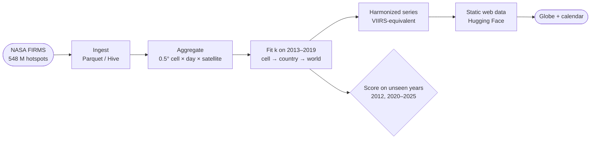

<div align="center">

# Fire Activity


### 25 years of satellite fire hotspots, MODIS and VIIRS merged into one continuous series — on a globe and a fire-activity calendar.

<a href="https://mediumvioletred-clam-174375.hostingersite.com"></a>

<sub>The real site, with the full worldwide dataset (2000–2025). Nothing to install.</sub>

<br>

**📊 [Read the pitch deck (PDF, 7 slides)](docs/submission/pitch-deck-en.pdf)** — the problem, our hierarchical conversion factor, a worked example on Argentina, and the validated result.

</div>

## The problem

The [CONAE](https://www.argentina.gob.ar/ciencia/conae) (Argentina's space agency) builds fire-activity calendars from satellite hotspots. Twenty-five years of hotspots exist, but from two sensor families that do not count the same thing: VIIRS (375 m, 2012→) sees about **4× more hotspots** than MODIS (1 km, 2000→). Raw counts cannot be chained, so once MODIS is retired, a decade of history becomes unusable. And since Suomi NPP stopped delivering on 2 November 2026, the series must now continue on NOAA-20.

Our answer: convert every year into a single unit, **VIIRS-equivalent hotspots**, and score that conversion on years it never saw.

## Highlights

- **One unit from 2000 to 2025** — MODIS × k before VIIRS, observed VIIRS after, NOAA-20 to carry on after Suomi NPP.
- **Half the error of a single global ratio** — on held-out years 2020–2025, country × month median error **14.2 %** vs 26.6 %; world × month **4.0 %** vs 8.2 % ([method](docs/methode-harmonisation.pdf), [results](results/resultats-harmonisation.html)).
- **Anomalies survive the conversion** — Spearman 0.895 between predicted and observed anomalies; 77 % of truly unusual months are still flagged as unusual.
- **The 2012 seam is invisible** — world × month error at the MODIS → VIIRS junction: 1.1 %.
- **NOAA-20 takes over cleanly** — calibrated on 2019–2021, country × month error 6.4 % on 2022–2025.
- **86 satellite outages** detected from the data itself, excluded from fitting and bridged with the next best satellite.
- **548 M detections**, worldwide, every day — explore any country, any day, down to the exact hotspot on the globe.

## What we built

| Area | Details |
|---|---|
| Ingestion | All NASA FIRMS standard archives (MODIS Terra/Aqua, VIIRS Suomi NPP, NOAA-20), 548.5 M rows, Parquet with Hive partitioning |
| Harmonization | Conversion factor k = VIIRS / MODIS per 1° cell and calendar month, shrunk towards country then world when data is thin; one predictor per fallback case (Terra+Aqua, Terra, Aqua, NOAA-20) |
| Validation | Calibration 2013–2019, hold-out 2020–2025 and 2012, scored at world, country, cell × month; error bands by activity level; baseline comparison |
| Web data | Static files only (series, globe points, exact detections, imagery tiles), no backend — published on Hugging Face |
| Frontend | React + Vite, MapLibre globe, calendar heatmap, season and daily charts, "vs usual" anomaly view, shareable URL state |
| Stack | Python 3.14, uv, Polars, pytest · Node 24, pnpm, TypeScript |

## How it works



Method in 7 slides: [docs/submission/pitch-deck-en.pdf](docs/submission/pitch-deck-en.pdf). Full method (in French): [docs/methode-harmonisation.pdf](docs/methode-harmonisation.pdf). Data files: [docs/web-data-contract.md](docs/web-data-contract.md).

## Data

| Dataset | Content |
|---|---|
| [NASA FIRMS](https://firms.modaps.eosdis.nasa.gov/) | Source: standard (science-quality) MODIS and VIIRS archives |
| [`cexplorers/fire-activity-web`](https://huggingface.co/datasets/cexplorers/fire-activity-web) | Everything the site loads (~2.7 GB), public |
| `cexplorers/firms-hotspots` | Raw ingested detections (8 GB) |

## Run it locally

Needs [uv](https://docs.astral.sh/uv/), Node 24 and pnpm. After the first download the site runs offline (only the deepest globe zoom levels and the web fonts come from the internet).

```bash
uv sync
uv run fetch-web-data        # ~2.7 GB from Hugging Face into frontend/public/data
cd frontend && pnpm install && pnpm dev
```

`uv run fetch-web-data --only tiles series` fetches only some folders.

<details>
<summary><b>Rebuild the data from scratch</b></summary>

```bash
uv run firms world           # ingest FIRMS detections into data/detections (~10 GB download)
uv run harmonize             # fit, validate, build the product -> data/product
uv run export-web            # calendar series -> frontend/public/data
uv run export-points --exact # globe points and exact detections
uv run fetch-tiles           # globe imagery, zoom 0-5
uv run upload-web-data       # publish frontend/public/data to Hugging Face
```

Tests: `uv run pytest`.

</details>

## Team

Built for the [NASA Space Apps Challenge 2026](https://www.spaceappschallenge.org/), CONAE challenge, by the Curious Explorers: [juca55](https://github.com/juca55).

<sub>Fire data: NASA FIRMS (LANCE / EOSDIS). Developed with the help of AI coding assistants (Claude).</sub>
